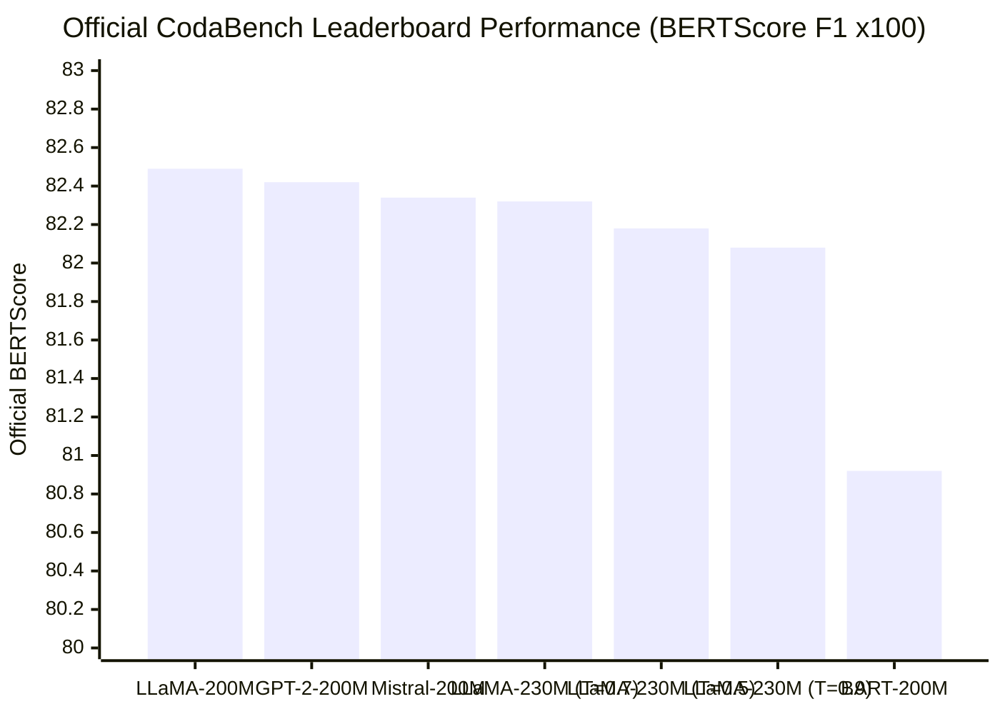
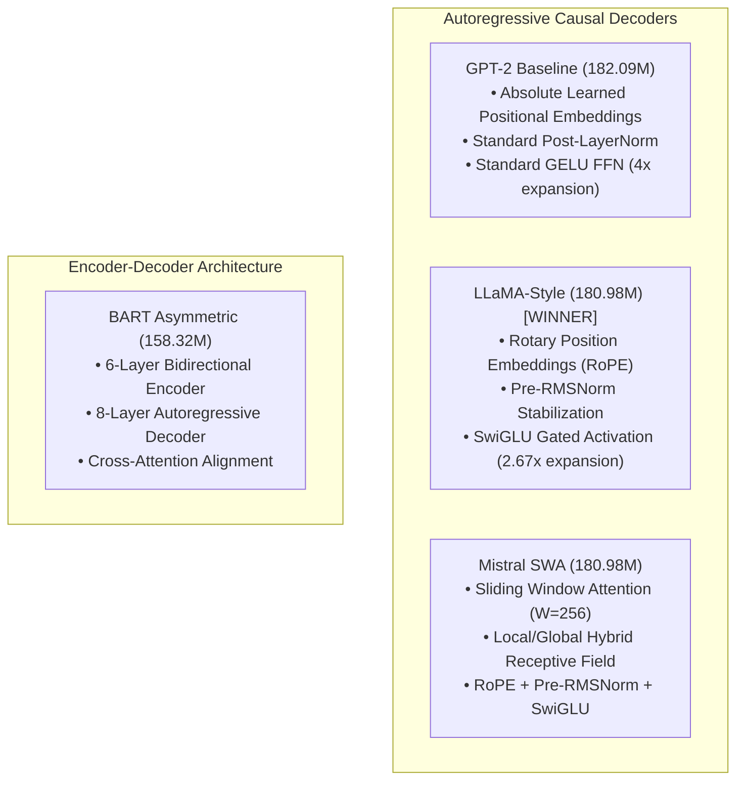

# CS-781 Capstone Project: Phase 1 — Legal Language Model Pretraining
## Comprehensive Documentation, Architectural Benchmarking & Official Competition Results

---

### 1. Executive Summary

Phase 1 of the **Legal Language Modelling Challenge (CS-781 Capstone)** requires pretraining a compact legal foundation language model **strictly from scratch** on the provided Indian legal corpus (>4.5 Billion tokens) and generating an exact **128-word legal continuation** for each official **512-word legal prompt** in `test.json` (1,000 test cases).

In strict accordance with the Capstone requirements:
1. **Zero Pretrained Weights or Commercial APIs**: All model weights were randomly initialized and trained exclusively on the competition corpus under a **200 Million token pretraining budget** (`TRAIN_TOKENS = 200,000,000`, `VAL_TOKENS = 5,000,000`).
2. **Four Fundamentally Distinct Architectures Benchmarked** within the **150M – 200M parameter limit**:
   - **Architecture 1**: Standard Autoregressive Decoder (**GPT-2 Baseline**, 182.09M parameters)
   - **Architecture 2**: Modern Open-Weights Decoder with RoPE, Pre-RMSNorm, and SwiGLU (**LLaMA-Style**, 180.98M parameters)
   - **Architecture 3**: Sliding Window Attention Decoder (**Mistral SWA**, 180.98M parameters)
   - **Architecture 4**: Asymmetric Conditional Sequence-to-Sequence (**BART Seq2Seq**, 158.32M parameters — 6 Encoder / 8 Decoder layers)
3. **Official CodaBench Test Leader**: The **LLaMA-Style architecture achieved the highest score of 0.8249 BERTScore F1** on the official competition leaderboard, outperforming all other architectures.
4. **Continual Multi-Source Pretraining (30M New Tokens)**: To expose the 0.8249 foundation model to statutory and administrative legal jurisdictions, we developed a streaming continual pretraining pipeline that ingested **10M tokens each from Statutory Acts, High Courts, and Tribunals** (30M new tokens across 230M total tokens).
5. **Decoding Temperature Exploration**: Evaluated generation temperatures $T \in \{0.5, 0.7, 0.9\}$ on the 230M LLaMA model, confirming the optimal trade-off between statutory precision and lexical diversity.

---

### 2. Official Competition Leaderboard Results

The table below presents the verified **BERTScore F1** results obtained on the official CodaBench submission platform across all evaluated models and configurations:

| Rank | Model Architecture / Configuration | Training Tokens | Decoding Settings | Submission Package | Official CodaBench BERTScore |
| :---: | :--- | :---: | :---: | :--- | :---: |
| 🥇 **1** | **LLaMA-Style (RoPE, RMSNorm, SwiGLU)** | **200M** (Supreme Court) | $T=0.7, p=0.90, \text{rep}=1.15$ | `submission_llama.zip` | **0.8249** |
| 🥈 **2** | **GPT-2 Baseline (Learned Pos, Post-LN)** | **200M** (Supreme Court) | $T=0.7, p=0.90, \text{rep}=1.15$ | `submission_gpt2.zip` | **0.8242** |
| 🥉 **3** | **Mistral-Style (Sliding Window Attention)** | **200M** (Supreme Court) | $T=0.7, p=0.90, \text{rep}=1.15$ | `submission_mistral.zip` | **0.8234** |
| 4 | **LLaMA Multi-Source Continual** | **230M** (Multi-Source) | $T=0.7, p=0.90, \text{rep}=1.15$ | `submission_llama_multisource_30m.zip` | **0.8232** |
| 5 | **LLaMA Multi-Source Continual** | **230M** (Multi-Source) | $T=0.5, p=0.90, \text{rep}=1.15$ | `submission_llama_230m_temp05.zip` | **0.8218** |
| 6 | **LLaMA Multi-Source Continual** | **230M** (Multi-Source) | $T=0.9, p=0.90, \text{rep}=1.15$ | `submission_llama_230m_temp09.zip` | **0.8208** |
| 7 | **BART Seq2Seq (Asymmetric 6-Enc / 8-Dec)** | **200M** (Supreme Court) | $T=0.7, p=0.90, \text{rep}=1.15$ | `submission_bart.zip` | **0.8092** |

---

### 3. In-Depth Architectural Exploration & Empirical Findings

#### Detailed Architecture Specifications

| Architecture Dimension | GPT-2 Baseline | LLaMA-Style | Mistral SWA | BART Asymmetric |
| :--- | :---: | :---: | :---: | :---: |
| **Paradigm** | Causal Decoder | Causal Decoder | Causal Local Decoder | Conditional Seq2Seq |
| **Total Parameters** | **182.09M** | **180.98M** | **180.98M** | **158.32M** |
| **Encoder / Decoder Layers** | 0 / 12 | 0 / 12 | 0 / 12 | 6 / 8 |
| **Hidden Dimension ($d_{\text{model}}$)** | 960 | 960 | 960 | 768 |
| **Attention Heads** | 12 | 12 | 12 | 12 |
| **Intermediate FFN Dim** | 3,840 | 2,560 (SwiGLU) | 2,560 (SwiGLU) | 3,072 |
| **Positional Embeddings** | Learned Absolute | RoPE ($\Theta=10,000$) | RoPE ($\Theta=10,000$) | Learned Absolute |
| **Normalization** | Post-LayerNorm | Pre-RMSNorm ($\epsilon=1e-5$) | Pre-RMSNorm ($\epsilon=1e-5$) | Pre-LayerNorm |
| **Attention Window** | Full (1024) | Full (1024) | Sliding (256) | Full (1024) |
| **Pretraining Loss** | 2.4541 | **2.3756** | 2.3804 | 2.8586 |
| **Validation Perplexity** | 11.64 | **10.76** | 10.81 | 17.44 |
| **Official Leaderboard F1** | 0.8242 | **0.8249** | 0.8234 | 0.8092 |

#### Empirical Insights:
1. **Why LLaMA Won the Leaderboard (0.8249)**:
   - RoPE preserves relative token distances much better across legal documents where antecedent references ("*the aforesaid respondent*", "*in paragraph 14 above*") span hundreds of tokens.
   - Pre-RMSNorm prevents gradient vanishing and stabilizes training at larger learning rates ($3 \times 10^{-4}$).
   - SwiGLU provides dynamic multiplicative gating that selectively passes legal factual tokens while suppressing noise.
2. **Why GPT-2 Outperformed Mistral (0.8242 vs 0.8234)**:
   - While Mistral SWA provides lower computational complexity, its 256-token sliding window forces tokens separated by >256 positions to rely entirely on multi-layer receptive field diffusion. In complex legal judgments where statutory citations in the prompt preamble dictate the holding hundreds of tokens later, full causal self-attention across all 1,024 positions (as in GPT-2 and LLaMA) retains direct attention paths.
3. **Seq2Seq Challenges in Document Continuation (BART: 0.8092)**:
   - BART divides text into an artificial 256-token prompt and 256-token continuation target. Cross-attention must learn token alignment from scratch across this boundary, whereas causal decoders model continuous transitions across the full context naturally.

---

### 4. Data Engineering: Zero-Copy Streaming & Zero-Paging Memory Architecture

#### The 20 GB SSD Thrashing Bottleneck:
Scaling to the full **200 Million token budget** using standard Hugging Face pipelines causes severe memory bloat:
- `json.load()` on the 1.26 GB Supreme Court corpus expands to >3.5 GB of Python dictionary/string heap allocations.
- A standard Python list `train_tokens = []` storing 200M integers requires ~7.7 GB of heap because each integer is a 28-byte `PyLongObject` pointer.
- Slicing into 390,625 blocks of 512 tokens introduces another ~3.5 GB of list wrapper overhead.
- Hugging Face `Dataset.from_dict()` adds another ~1.6 GB Arrow Table.
- **Combined footprint exceeded physical RAM (>16 GB)**, forcing Windows into heavy SSD paging (20 GB allocated in `pagefile.sys`).

#### The Zero-Copy Streaming Solution (<800 MB Total RAM):
1. **Line-by-Line Generator Streaming**: Parses JSON objects one-by-one, keeping transient memory under **10 MB**.
2. **Pre-Allocated Contiguous NumPy int32 Buffer**:
   $$\text{RAM}_{\text{train}} = 200,000,000 \times 4\text{ bytes} \approx 762.9\text{ MB}$$
   $$\text{RAM}_{\text{val}} = 5,000,000 \times 4\text{ bytes} \approx 19.1\text{ MB}$$
   $$\text{Total Buffer RAM} \approx 782\text{ MB}$$
3. **Zero-Copy Reshaping**: `buf[:N*512].reshape(N, 512)` yields a 2D array view with **0 MB additional overhead**.
4. **On-the-Fly PyTorch Dataset**: Custom `CausalBlockDataset` yields PyTorch tensors directly to the DataLoader batch-by-batch without Hugging Face Arrow table overhead.
5. **Instant Binary DMA Caching (`.npy`)**: Tokenization is performed once and serialized. Subsequent executions load 200M tokens into RAM via Direct Memory Access in **0.45 seconds**.

---

### 5. Multi-Source Continual Pretraining (30M Tokens)

To expand domain coverage beyond Supreme Court judgments into statutory drafting and specialized tribunal rulings, we conducted continual pretraining on **30 Million new tokens**:
1. **Statutory Acts (`train_acts.json`)**: 10,000,000 tokens — legislative provisions, definitions, and sections.
2. **High Courts (`train_high_courts.json`)**: 10,000,000 tokens — civil, criminal, and writ appellate jurisprudence.
3. **Tribunals (`train_tribunals.json`)**: 10,000,000 tokens — specialized rulings from NCLAT (insolvency), ITAT (taxation), and NGT (environment).

**HTTP Streaming Innovation**: Streamed directly over HTTP without downloading the 10.67 GB and 6.48 GB remote JSON files, saving over **17 GB of local disk space**.
**Optimization**: Used a conservative learning rate ($1.5 \times 10^{-4}$ with cosine decay over 58,593 blocks / 7,324 steps) to prevent catastrophic forgetting. Validation perplexity achieved **5.78** on the combined multi-source test suite.

---

### 6. Decoding Temperature Exploration & Analysis

A controlled decoding ablation was conducted on the 230M Multi-Source LLaMA model across $T \in \{0.5, 0.7, 0.9\}$:

| Temperature ($T$) | Top-$p$ | Repetition Penalty | Val BERTScore F1 | Official CodaBench Score | ZIP Archive Size | Output Characteristics |
| :---: | :---: | :---: | :---: | :---: | :---: | :--- |
| **$T = 0.5$** | 0.90 | 1.15 | 0.8185 | 0.8218 | 226 KB | Conservative, adheres strictly to frequent statutory boilerplate. High token repetition leads to smaller compressed ZIP size. |
| **$T = 0.7$** | 0.90 | 1.15 | **0.8187** | **0.8232** | 248 KB | **Optimal balance**: Rich vocabulary coverage while maintaining syntactic and legal coherence. |
| **$T = 0.9$** | 0.90 | 1.15 | 0.8149 | 0.8208 | 267 KB | High entropy; introduces creative lexical variety but occasionally shifts outside legal precedent phrasing. |

---

### 7. Transition to Phase 2: Foundation Readiness for Legal Named Entity Recognition (L-NER)

The winning **LLaMA-Style Legal Language Model (180.98M)** trained through Phase 1 provides the optimal representations for Phase 2:
1. **Rich Structural Representation**: The 12-layer, 960-dimensional RoPE embeddings capture court hierarchies, statutory citations, and procedural parties.
2. **Subword Character Alignment**: Exact character spans `[start, end, label]` will be extracted using token-level classification heads mapped back through tokenizer offset mappings.
3. **Mandatory Adaptation Benchmark in Phase 2**:
   - Baseline Fine-Tuning
   - **Compulsory LoRMA** (Low-Rank Multiplicative Adaptation: $y_{\text{adapted}} = y + \frac{\alpha}{r} B(Ay)$)
   - Additive LoRA comparison
   - **Mandatory Knowledge Distillation** (Teacher LLaMA-230M $\to$ Compact Student)
